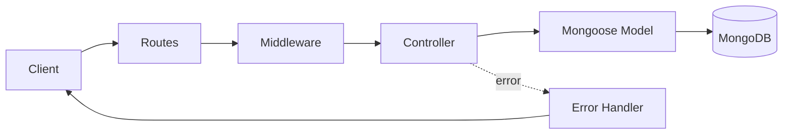

# 📝 Todo API


A Todo REST API with user authentication, built from scratch to practice backend fundamentals: routing, middleware, JWT, cookies and MongoDB relations.

> 🚧 **Work in progress.** I'm building this step by step. The checklist below shows exactly what's done.

---

## ✨ Features

| Feature | Status |
|---|---|
| Project setup, MongoDB connection | ✅ Done |
| User registration (validation, duplicate check, bcrypt hashing) | ✅ Done |
| Centralized error handling (`ApiError`, `asyncHandler`) | ✅ Done |
| Login with JWT stored in an HTTP-only cookie | 🔨 In progress |
| Auth middleware (`verifyJWT`) | ⏳ Planned |
| Todo CRUD (each user sees only their own todos) | ⏳ Planned |
| Logout | ⏳ Planned |
| Simple frontend (HTML, CSS, JS) | ⏳ Planned |

---

## 🔌 API Endpoints

Base URL: `/api/v1`

| Method | Endpoint | Description | Auth | Status |
|---|---|---|---|---|
| POST | `/users/register` | Register a new user | No | ✅ |
| POST | `/users/login` | Login, sets cookie | No | 🔨 |
| POST | `/users/logout` | Clear cookie | Yes | ⏳ |
| GET | `/todos` | Get my todos | Yes | ⏳ |
| POST | `/todos` | Create a todo | Yes | ⏳ |
| PATCH | `/todos/:id` | Toggle complete | Yes | ⏳ |
| DELETE | `/todos/:id` | Delete a todo | Yes | ⏳ |

**Example: register**

```http
POST /api/v1/users/register
Content-Type: application/json

{
  "username": "aman",
  "email": "aman@test.com",
  "password": "12345678"
}
```

Response (`201 Created`): the user without the password field.

---

## 🧭 How a request flows



---

## 🗂️ Project Structure

```
todo-api/
├── public/              # static frontend
├── src/
│   ├── controllers/     # request logic
│   ├── db/              # MongoDB connection
│   ├── middlewares/     # auth, etc.
│   ├── models/          # Mongoose schemas
│   ├── routes/          # API routes
│   ├── utils/           # ApiError, ApiResponse, asyncHandler
│   ├── app.js           # Express app setup
│   ├── constants.js
│   └── index.js         # entry point
├── .env.example
├── .gitignore
└── package.json
```

---

## 🛠️ Tech Stack

- **Node.js** and **Express 5**: server and routing
- **MongoDB** and **Mongoose**: database and schemas
- **bcryptjs**: password hashing
- **jsonwebtoken**: access tokens
- **cookie-parser**: reading cookies
- **dotenv**: environment variables
- **nodemon**: auto-restart in development

---

## 🚀 Getting Started

```bash
# 1. Clone
git clone https://github.com/AmanBhardwazzz17/todo-api.git
cd todo-api

# 2. Install dependencies
npm install

# 3. Create your .env file (see below)
cp .env.example .env

# 4. Run in development
npm run dev

# Run the registration validation tests
npm test
```

**.env.example**

```env
PORT=8000
MONGODB_URI=mongodb://127.0.0.1:27017/todo_api
ACCESS_TOKEN_SECRET=your_random_secret
ACCESS_TOKEN_EXPIRY=1d
```

The server starts only after the database connects successfully.

---

## 📚 What I'm learning here

- Why the server starts only after the DB connects
- How middleware works and why `next()` matters
- Password hashing with a Mongoose `pre("save")` hook
- Access token vs refresh token, and why cookies are `httpOnly`
- Correct HTTP status codes (`201`, `400`, `409`)

---

## 👤 Author

**Aman Bhardwazz**
BS CS & Data Analytics student at IIT Patna
GitHub: [@AmanBhardwazzz17](https://github.com/AmanBhardwazzz17)# todo-api
